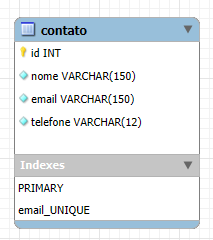

# Lista de contatos

Projeto com intuito acadêmico, com o objetivo de colocar o aprendizado teórico na prática.

## Sobre o projeto

Um projeto CRUD que armazena dois tipos de meios de contato, e-mail, telefone e o nome referente a eles. Também utiliza 
uma interface feita a partir do windows-form onde o usuário é capaz de inserir um novo contato, atualizar ou deletar um 
existente e pesquisar pelos contatos salvos.

## Tecnologias utilizadas

- C#
- Windows Form
- SQL
- MySQL

## Funcionalidades

- [x] CREAT
- [x] READ
- [x] UPADATE
- [x] DELETE

## Estrutura do banco de dados

## Como executar

1. Clone o repositório.
2. Acesse a pasta do projeto.
3. Inicialize o arquivo executável.

## Limitações conhecidas do projeto

- Baixa escalabilidade: não foi feita para receber grandes volumes de dados.
- Interface limitada: o sistema funciona exclusivamente como aplicação desktop windows, não possuindo uma interface web.
- Limitações de segurança: Não possui sistema de autenticação ou gerenciamento
   de usuários ou controle de acesso.

## Aprendizados

Foi possível por meio deste projeto entender na prática como interligar um banco de dados a uma interface através de
uma linguagem, permitindo com que dados sejam inseridos e alterados.

- LinkedIn: [linkedin/nicolas-machado-carlos](www.linkedin.com/in/nicolas-machado-carlos)
